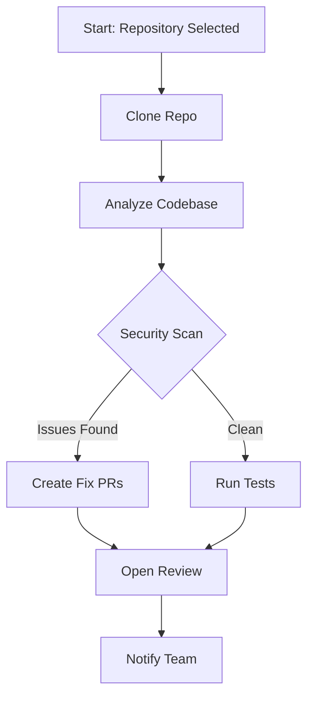

<script type="application/ld+json" set:html={JSON.stringify({
  "@context": "https://schema.org",
  "@type": "BlogPosting",
  "headline": "OpenHands v1.37 Just Gave Every Automation a Mermaid Diagram — See Exactly What Your Agent Will Do Before It Runs",
  "description": "OpenHands v1.37.0 (Nov 6) adds Mermaid diagrams to every automation template so you see the flow before you run it. Plus: fixed session resume ordering, kept conversation titles visible during startup, and stopped empty chat suggestions from flashing. Agent Canvas desktop app ships same version.",
  "image": "https://terminalblog.com/api/og?title=OpenHands+v1.37+Mermaid+Diagrams&tool=openhands",
  "datePublished": "2026-11-09T14:00:00Z",
  "dateModified": "2026-11-09T14:00:00Z",
  "author": {
    "@type": "Person",
    "name": "Anshad"
  },
  "publisher": {
    "@type": "Organization",
    "name": "TerminalBlog",
    "logo": {
      "@type": "ImageObject",
      "url": "https://terminalblog.com/favicon.ico"
    }
  },
  "mainEntityOfPage": {
    "@type": "WebPage",
    "@id": "https://terminalblog.com/blog/openhands-v1-37-agent-canvas-automations-mermaid-diagrams/"
  }
})} />

**OpenHands v1.37.0 dropped November 6, 2026** — and the headline feature is something you'll actually use every time you set up an automation: **every template now shows a Mermaid diagram of its flow**. You see exactly what the agent will do, in what order, with what dependencies — before you click run.

Agent Canvas (the desktop app) ships v1.37.0 simultaneously: deb, dmg, exe, and AppImage all updated.

---

## The One-Line Summary

**OpenHands v1.37.0 (Nov 6) → Every automation template gets a Mermaid flow diagram, session resume orders conversations correctly (UTC), conversation titles stay visible during startup handoff, empty chat suggestions no longer flash prematurely. Agent Canvas desktop app updated same version. 1 feature, 4 fixes, 0 breaking changes.**

---

## The Headline Feature: Automation Templates Now Show Mermaid Diagrams

### The Problem: "What Will This Automation Actually Do?"

Before v1.37, picking an automation template meant reading a description and hoping it matched your mental model. You'd run it, watch it do something unexpected, then spend time figuring out *why*.

### The Fix: Visual Flow Before You Commit

**New in v1.37:** Every automation template now renders a **Mermaid diagram** showing the complete execution flow ([#19318](https://github.com/OpenHands/OpenHands/pull/19318)).



**What you see before running:**
- Every step in order
- Decision points (diamonds = conditional branches)
- Parallel paths
- Where human approval gates sit
- External service calls (GitHub, Jira, Slack, etc.)

**For beginners:** This is the "show me the recipe before I cook" feature. You don't need to read YAML or understand the automation engine — the diagram *is* the documentation.

---

## The Fixes You'll Notice Daily

### 1. Session Resume Orders Conversations Correctly (UTC)

**Fixed:** Resumed sessions now appear **after** UTC conversation history instead of before ([#19400](https://github.com/OpenHands/OpenHands/pull/19400)).

```bash
# Before: Resume session → shows at top, pushes history down
# After:  Resume session → slots into correct chronological position
```

**Why it matters:** Your chat timeline stays logically ordered. No more "wait, did I send that before or after the resume?"

### 2. Conversation Titles Stay Visible During Startup Handoff

**Fixed:** Generated conversation titles no longer disappear during the startup handoff animation ([#19404](https://github.com/OpenHands/OpenHands/pull/19404)).

```bash
# Before: Title flashes → disappears → reappears (or stays gone)
# After:  Title stays put. You always know which conversation you're in.
```

### 3. Empty Chat Suggestions Wait for Session Replay

**Fixed:** The "start a new conversation" suggestions no longer appear **before** the session replay completes ([#19377](https://github.com/OpenHands/OpenHands/pull/19377)).

```bash
# Before: Open app → see suggestions → history loads → suggestions replaced
# After:  Open app → history loads → suggestions appear (if history empty)
```

### 4. Home Page Loads Without Trailing Slash Redirect

**Fixed:** The home page now loads at the base path without a trailing slash redirect ([#19406](https://github.com/OpenHands/OpenHands/pull/19406)).

```bash
# Before: GET / → 301 → GET / → page loads
# After:  GET / → 200 → page loads (one less round-trip)
```

### 5. Performance: No More Repeated History Scans During Live Updates

**Improved:** Chat avoids repeated history scans when live updates arrive ([#19266](https://github.com/OpenHands/OpenHands/pull/19266)).

```bash
# Before: Each live update → full history scan → UI update
# After:  Live updates → incremental diff → UI update (much faster on long conversations)
```

---

## Agent Canvas Desktop App: v1.37.0 Same-Day Ship

The desktop app (Agent Canvas) releases **in lockstep** with the web version:

| Platform | Asset |
|----------|-------|
| **Linux (deb)** | `agent-canvas_1.37.0_amd64.deb` |
| **macOS (universal)** | `OpenHands-Agent-Canvas-1.37.0-universal.dmg` |
| **Windows** | `OpenHands-Agent-Canvas-Setup-1.37.0.exe` |
| **Linux (AppImage)** | `OpenHands.Agent.Canvas-1.37.0.AppImage` |

**macOS note:** The app isn't signed with an Apple Developer ID yet. macOS may call it "damaged" — it's Gatekeeper quarantine, not a bad file. Fix:

```bash
xattr -dr com.apple.quarantine "/Applications/OpenHands Agent Canvas.app"
```

---

## What This Means for You

### If You're New to OpenHands

**v1.37 makes automation approachable.** The Mermaid diagrams mean you can:
1. Browse templates visually
2. Pick one that matches your workflow
3. Run it with confidence

No YAML reading required. The diagram *is* the spec.

### If You Run Automations in Production

- **Visual audit trail** — every automation run has a diagram showing what *should* happen
- **Easier debugging** — when something breaks, compare actual execution to the diagram
- **Team onboarding** — new members understand automations by looking, not reading

### If You Use Agent Canvas Desktop

- **Same features, native app** — Mermaid diagrams render in the desktop UI
- **Offline-capable** — diagrams work without internet (Mermaid renders client-side)
- **Auto-updates** — check Settings → Updates or download from releases

---

## Quick Version Context

| Version | Date | Channel | Highlights |
|---------|------|---------|------------|
| **v1.37.0** | **Nov 6, 2026** | **Stable (Latest)** | **Mermaid diagrams for every automation, UTC resume ordering, startup title persistence, no-flash suggestions, performance** |
| v1.36.0 | Nov 5, 2026 | Stable | Massive automation UX overhaul: template suggestions, Data Center support, service accounts, unified workflows |
| v1.35.0 | Nov 3, 2026 | Stable | Conversation archive, markdown artifacts, context meter |
| v1.34.0 | Oct 27, 2026 | Stable | Docker runtime per conversation |

---

## How to Update

### Web / Self-Hosted (Docker)

```bash
# Pull latest
docker pull ghcr.io/all-hands-ai/openhands:1.37.0

# Or use the tag that always points to latest stable
docker pull ghcr.io/all-hands-ai/openhands:latest
```

### Agent Canvas Desktop

**Auto-update (recommended):**
1. Open Agent Canvas
2. Settings → Updates → Check for Updates
3. Restart when prompted

**Manual download:**
- [GitHub Releases v1.37.0](https://github.com/OpenHands/OpenHands/releases/tag/v1.37.0)
- Pick your platform asset

### Verify Your Version

```bash
# In Agent Canvas: Help → About → shows 1.37.0
# In Web UI: Footer or Settings → Version
# CLI (if using): openhands --version
```

---

## First Things to Try After Update

```bash
# 1. Browse automation templates — look for the Mermaid diagrams
# In Agent Canvas: Automations → Browse Templates
# Click any template → diagram renders instantly

# 2. Test session resume ordering
# Close a session with history → reopen → verify chronological order

# 3. Watch startup — conversation title should never disappear

# 4. Open empty chat — suggestions appear AFTER history loads (instant on fast machines)

# 5. Test performance on long conversation
# Scroll through 1000+ message chat → live updates should feel snappy
```

---

## The Bigger Picture: OpenHands Is Making Automation Visual

```
v1.30–v1.33  → Platform foundation: ACP, Docker runtime, cloud sync
v1.34.0      → Docker runtime per conversation (isolation)
v1.35.0      → Conversation artifacts, context visibility
v1.36.0      → Automation UX overhaul: templates, service accounts, Data Center
v1.37.0      → **Visual automation contracts (Mermaid) + polish**
```

**Every release since v1.34 has been about making the platform operable.** v1.36 gave you templates. v1.37 makes those templates *inspectable*.

The pattern: **OpenHands doesn't just ship features — it ships observability for those features.** You don't guess what an automation does. You *see* it.

---

## Related Articles

- [OpenHands v1.35 Just Gave You Cloud Memory, Markdown Artifacts, and a Context Meter](/blog/openhands-v1-35-0-cloud-remembers-repo-drag-sidebar-agent-status/)
- [OpenHands v1.34 Just Made Every Conversation Get Its Own Docker Runtime](/blog/openhands-v1-34-0-docker-runtime-per-conversation/)
- [OpenHands Agent Canvas Desktop App Changes Everything — Your Agent Finally Has a Real Home](/blog/openhands-agent-canvas-desktop-app-changes-everything/)
- [Best Coding Agents 2026 Decision Guide — 12 Options Compared](/blog/best-coding-agents-2026-decision-guide/)

---

## Related articles

- [Claude Code v2.1.319 Just Made MCP Tools Background-Ready — Your Long-Running Tasks Finally Work Right](/blog/claude-code-v2-1-319-mcp-tasks-background-auto-mode/)
- [Opencode v2.2.6 Just Made MCP Connections Shared — And Plugins Got Themes, Mobile Got a Dock, Worktrees Got Scriptable](/blog/opencode-v2-2-6-shared-mcp-plugin-themes-mobile-worktrees/)
- [Kilo Code v7.8.27 Just Patched Critical Supply-Chain Vulnerabilities — Update Now](/blog/kilocode-v7-8-27-critical-security-patch/)

---

*OpenHands v1.37.0 released November 6, 2026. Full changelog: [github.com/OpenHands/OpenHands/releases/tag/v1.37.0](https://github.com/OpenHands/OpenHands/releases/tag/v1.37.0). Agent Canvas desktop app assets included. OpenHands is open-source (MIT) and built by [All Hands AI](https://github.com/All-Hands-AI).*

*Why pay $20/mo for ChatGPT, $20/mo for Claude, $20/mo for Gemini? **[aiFiesta](https://aifiesta.link/muhammed-anshad)** gives you all of them and more for just $12/mo. One subscription, every answer.*